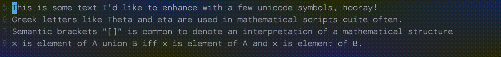

# abbrev-expand.nvim

## Preview



## Setup

Setup used in the demo (press `<C-]>` at the end of an abbreviation in insert mode, on its last character in normal mode, or with it selected in visual mode to expand):

```lua
require('abbrev-expand').setup {
  map = {
    {"hooray", "🥳"},
    {"eta", "η"},
    {"Theta", "theta"},
    {"[", "⟦"},
    {"]", "⟧"},
    {"union", "∪"},
    {"iff", "⇔"},
    {"and", "∧"},
    {"elem", "∈"}
 }
}

vim.api.nvim_set_keymap('i', '<C-]>', '<Left><C-o>:lua require("abbrev-expand").expand(".")<CR><Right>',
                        {noremap = true, silent = true})
vim.keymap.set('n', '<C-]>', require('abbrev-expand').expand_repeatable, {expr = true})
vim.keymap.set('x', '<C-]>', function() return '<Esc>`>' .. require('abbrev-expand').expand_repeatable() end,
               {expr = true})

```

Expansions made in normal and visual mode can be repeated with `.`: after expanding one abbreviation, put the cursor on the last character of another and press `.` to expand it too. Insert-mode expansions can't be repeated this way, because `.` repeats the text you typed.
